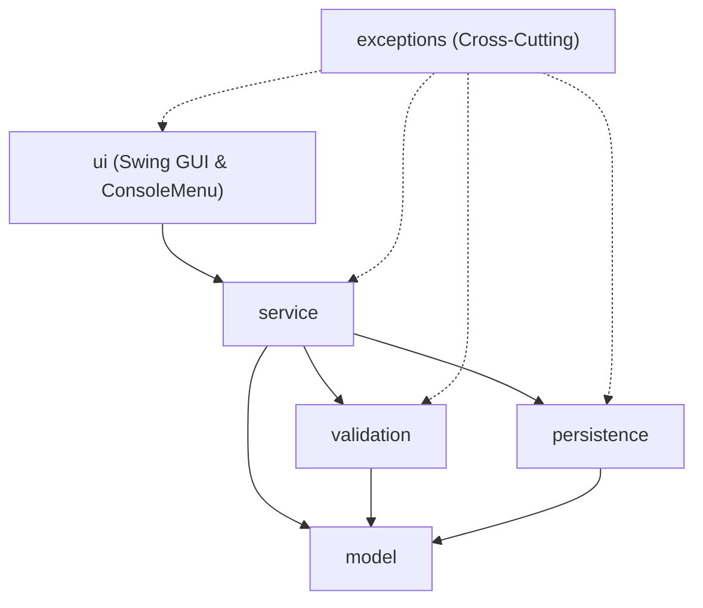

# GameZone Unicesar

Comprehensive inventory, accessories, people, sales, promotions, returns, warranties, and financial balance management system for GameZone Unicesar. Developed as Taller 2 for Programación de Computadores III (SS462), Ingeniería de Sistemas, Universidad Popular del Cesar.

## About

GameZone Unicesar is a specialized video game and console store located in Valledupar's university sector. The system manages the full retail cycle: products (video games and consoles), specialized accessories, customer and seller records, sales transactions, dynamic promotional campaigns, post-sale returns with inventory reintegration, and warranty lifecycle tracking.

The application features both a rich **Java Swing Graphical User Interface (GUI)** and an interactive **Console Menu**, built upon a strict four-layer architecture (`model`, `persistence`, `service`, `ui`), with robust file-based persistence via Java serialization (`ObjectOutputStream`/`ObjectInputStream`), ensuring data integrity across sessions without requiring an external database.

## Architecture

The codebase is organized into distinct layers under the root package `com.gamezone`, adhering strictly to a one-directional dependency rule: `ui → service → validation → model` and `ui → service → persistence → model`, with `exceptions` serving as a cross-cutting package.

- `model`: Domain entities, business value objects, and inheritance hierarchies. Depends on nothing else.
- `exceptions`: Cross-cutting custom exception hierarchy rooted at `GameZoneException` (`RuntimeException`), with specialized subclasses `ResourceNotFoundException`, `BusinessRuleException`, `InvalidDataException`, and `PersistenceException`.
- `validation`: Dedicated static validators per functional module (`ProductValidator`, `PersonValidator`, `SaleValidator`) invoked by the service layer before executing business logic. Depends only on `model` and `exceptions`.
- `persistence`: Repositories and DTO records responsible for saving and loading data files, wrapping low-level `IOException` errors into `PersistenceException` with file and operation context. Depends only on `model` and `exceptions`.
- `service`: Business rules, transaction coordination, stock updates, discount algorithms, and reporting. Delegates validations to `validation` and depends on `model`, `persistence`, `validation`, and `exceptions`.
- `ui`: Presentation layer including the Swing graphical interface (`MainFrame`, sub-panels, dialogs) and `ConsoleMenu`, featuring differentiated exception catching to provide clear Spanish error messages by category. Depends on `service`, `model`, and `exceptions`.

See the full architectural diagram and rationale in [docs/layers-diagram.md](docs/layers-diagram.md) and the exception layer diagram in [docs/exception-class-diagram.md](docs/exception-class-diagram.md).



### Design Note: Persistence DTO Records

To preserve the strict separation of layers without circular dependencies or foreign layer leakage, persisted transactions do not serialize nested runtime entity graphs. Instead, they leverage dedicated Data Transfer Objects (DTOs):
- `SaleRecord`: Stores references via customer, seller, and product/accessory IDs alongside promotional discount information.
- `ReturnRecord`: Stores the original sale ID, returned product IDs, return date, reason, and refund amount.
- `WarrantyRecord`: Stores warranty details linked to product and sale IDs with start and expiration dates.

Entity resolutions and object-graph reconstructions are executed cleanly within the service layer (`SaleService`, `ReturnService`, `WarrantyService`), preventing desynchronization across files.

## Features & Modules

### 1. Products Management
- **Video Games:** Platform, genre, rating, price, and stock tracking.
- **Consoles:** Brand, model, generation, price, and stock tracking.
- Real-time stock decrement upon sale registration.

### 2. Accessories Management (RE1)
- Specialized accessories extending the `Product` hierarchy:
  - **Controllers:** Wired/wireless connectivity and compatible console model mapping.
  - **Cables:** Length in meters and connector types (HDMI, USB, Optical, etc.).
  - **Memories:** Storage capacity in GB and format (SD, MicroSD, Internal).
- Query accessories by category and verify real-time compatibility with specific console models.
- Preloaded default accessories (`A001`, `A002`, `A003`) on first initialization.

### 3. Promotions & Discounts (RE2 & RE5-A1)
- Dynamic promotional rules evaluated at checkout over the product subtotal:
  - **Percentage Discount:** Flat percentage off the entire product subtotal.
  - **Category Discount:** Targeted discount applying to `"VIDEOGAME"`, `"CONSOLE"`, or `"ACCESSORY"` (`instanceof Accessory` covering `Controller`, `Cable`, and `Memory`).
  - **Bulk Purchase Discount:** Tiered discount triggered when purchasing a minimum volume of items.
- Automated selection algorithm in `PromotionService.findBestPromotionFor` to grant the highest customer savings.
- Preloaded default promotions (`PROMO001` through `PROMO004`) on first initialization.

### 4. Returns, Proportional Refunds & Warranty Cancellation (RE3, RE5-A4, RE5-A5, RE5-A7)
- Formal return processing linked to historical sales within the **30-day return window**.
- **Automated stock restoration:** Restores returned inventory via `ProductService.restoreStock` (for video games and consoles) or `AccessoryService.restoreStock` (for accessories).
- **Proportional discount refund:** When returning items from a discounted sale, refunds the exact proportional amount paid per item (`price * (1 - discount / subtotal)`).
- **Automatic warranty cancellation:** Returning a `Console` cancels its `BasicWarranty` and/or `ExtendedWarranty` in `warranties.dat` via `WarrantyService.cancelWarranties` and adds any extended warranty surcharge to the total refund.

### 5. Warranties Management & Unified Checkout (RE4, RE5-A2, RE5-A3)
- **Basic Warranty:** Automatically assigned to every console sold (6-month coverage at `$0.0` additional cost).
- **Extended Warranty:** Optional 12-month coverage applied during checkout with a 10% console price surcharge (`extendedWarrantyCost`), kept separate from product `subtotal` so percentage discounts apply strictly to product prices (`total = subtotal - discount + extendedWarrantyCost`).
- Acyclic constructor dependency injection across `WarrantyService`, `SaleService`, and `ReturnService`.

### 6. People Management
- **Customers:** Personal details, contact information, email, and purchase history.
- **Sellers:** Employee code, work shifts, and attended sales history.
- Preloaded staff data (`V001`, `V002`, `V003`) on first initialization.

### 7. Reports & Monthly Financial Balance (RE5-A6)
- Complete sales, returns, and warranty audit history.
- **Monthly Financial Balance:** Exposes `calculateMonthlySales(month, year)`, `calculateMonthlyReturns(month, year)`, and `generateMonthlyBalance(month, year)` in `ReturnService`, displaying all three values in both `ConsoleMenu` and `ReportsPanel`.

### 8. Graphical User Interface (Swing GUI)
- Interactive sidebar navigation with real-time panel switching.
- Dedicated management views: Customers, Sellers, Products, Accessories, Sales, Promotions, Returns, Warranties, and Reports.
- Dynamic search filtering, modal creation forms with input validation, and detailed receipt preview dialogs.

### 9. Exception Handling & Validation Layer (RE6)
- **Custom Exception Hierarchy (`com.gamezone.exceptions`):** Rooted at abstract `GameZoneException` (`RuntimeException`) with error codes and four specialized subclasses:
  - `ResourceNotFoundException` (`ERR-NOT-FOUND`): Thrown when a requested product, accessory, customer, seller, or sale ID does not exist.
  - `BusinessRuleException` (`ERR-BUSINESS-RULE`): Thrown when a domain rule is violated (insufficient stock, duplicate ID, empty sale cart, expired 30-day return window).
  - `InvalidDataException` (`ERR-INVALID-DATA`): Thrown when input parameters fail format or range checks (blank strings, negative prices/quantities, invalid email format).
  - `PersistenceException` (`ERR-PERSISTENCE`): Wraps `IOException` and `ClassNotFoundException` in repositories with file path and read/write operation context.
- **Dedicated Validators (`com.gamezone.validation`):** `ProductValidator`, `PersonValidator`, and `SaleValidator` centralize input and domain verification before service operations execute.
- **Differentiated User Messaging:** `ConsoleMenu` and Swing dialogs catch each specific exception subtype to display clear, category-specific messages in Spanish without exposing technical stack traces.

### 10. GRASP Patterns Audit & Refactoring (RE7)
- **Phase 1 — Individual & Consolidated Audits (`docs/grasp-audit/`):** Systematic evaluation of all 35 non-UI classes across the 9 GRASP patterns (*Information Expert*, *Creator*, *Controller*, *Low Coupling*, *High Cohesion*, *Polymorphism*, *Pure Fabrication*, *Indirection*, *Protected Variations*), identifying 7 in-scope violations (`V-01`–`V-07`) and 2 out-of-scope structural observations (`F-01`, `F-02`).
- **Phase 2 — Behavior-Preserving Refactoring (`docs/grasp-refactor-log.md`):**
  - *Polymorphism (`V-02`):* Added `Product.getCategory()` and `Product.belongsToCategory(String)` to replace `instanceof` chains in `CategoryDiscount`.
  - *Information Expert (`V-01`, `V-03`, `V-04`):* Delegated discount ratio calculation to `Sale.getDiscountRatio()`, console compatibility checks to `Accessory.isCompatibleWith(String)`, and sale item lookups to `Sale.findProductById(String)`.
  - *Pure Fabrication & High Cohesion (`V-05`, `V-07`):* Centralized subtype and promotion validations in `ProductValidator`, extracted catalog lookup and stock helpers in `SaleService`, and enforced positive quantity checks in `ProductService.restoreStock`.
  - *Low Coupling (`V-06`):* Added `AccessoryService(AccessoryRepository)` constructor so `Main` no longer invokes `accessoryRepository.loadAll()` directly.

## Requirements

- Java 17 or later
- Maven 3.8 or later

## Build

```bash
mvn clean compile
```

To run unit tests:
```bash
mvn test
```

## Run

Run the application with:
```bash
mvn exec:java
```
Or explicitly:
```bash
mvn exec:java "-Dexec.mainClass=com.gamezone.Main"
```

## Persistent Storage (`data/`)

All data is serialized into binary `.dat` files inside the `data/` folder:
- `data/sellers.dat` (Preloaded with 3 default sellers on first run)
- `data/customers.dat`
- `data/products.dat`
- `data/Accessory.dat` (Preloaded with 3 default accessories on first run)
- `data/sales.dat`
- `data/promotion.dat` (Preloaded with 4 default promotions on first run)
- `data/returns.dat`
- `data/warranties.dat`

## Repository Structure

```
GameZoneUnicesar/
├── README.md
├── TEAM.md
├── pom.xml
├── .gitignore
├── data/
│   └── (serialized data files)
├── docs/
│   ├── analysis.md
│   ├── accessory-analysis.md
│   ├── promotion-analysis.md
│   ├── return-analysis.md
│   ├── warranty-analysis.md
│   ├── integration-analysis.md
│   ├── exception-analysis.md
│   ├── grasp-analysis.md
│   ├── grasp-refactor-log.md
│   ├── hierarchy-diagram.md
│   ├── class-diagram.md
│   ├── integrated-class-diagram.md
│   ├── exception-class-diagram.md
│   ├── grasp-class-diagram.md
│   ├── accessory-class-diagram.md
│   ├── promotion-class-diagram.md
│   ├── return-class-diagram.md
│   ├── warranty-class-diagram.md
│   ├── layers-diagram.md
│   ├── grasp-audit/
│   │   ├── developer1-audit.md
│   │   ├── developer2-audit.md
│   │   ├── leader-audit.md
│   │   └── consolidated-audit.md
│   └── ai-usage/
│       ├── leader-ai-log.md
│       ├── developer1-ai-log.md
│       └── developer2-ai-log.md
└── src/
    ├── main/
    │   ├── java/
    │   │   └── com/
    │   │       └── gamezone/
    │   │           ├── Main.java
    │   │           ├── exceptions/
    │   │           ├── model/
    │   │           ├── persistence/
    │   │           ├── service/
    │   │           ├── ui/
    │   │           └── validation/
    │   └── resources/
    │       └── images/
    └── test/
        └── java/
```

## Team

See [TEAM.md](TEAM.md) for detailed role allocations, module ownership, class distribution, and individual committed activities:
- **Merlin Landero (`mlanderoc`):** Technical Lead — Sales, UI (Swing GUI & Console), System Integration & Reports.
- **Carlos Gomez (`craulgomez`):** Developer 1 — Domain Models, Hierarchies, Custom Exceptions & Validators.
- **Héctor Guevara (`Hectorguevara22`):** Developer 2 — Persistence Repositories & Services.

## Documentation & Diagrams

- [TEAM Documentation](TEAM.md)
- [System Analysis](docs/analysis.md) | [Integration Analysis (RE5)](docs/integration-analysis.md) | [Exception Analysis (RE6)](docs/exception-analysis.md) | [GRASP Analysis (RE7)](docs/grasp-analysis.md)
- [Consolidated GRASP Audit](docs/grasp-audit/consolidated-audit.md) | [GRASP Refactoring Log](docs/grasp-refactor-log.md)
- [Integrated Class Diagram](docs/integrated-class-diagram.md) | [Exception Class Diagram (RE6)](docs/exception-class-diagram.md) | [GRASP Class Diagram (RE7)](docs/grasp-class-diagram.md) | [Class Diagram](docs/class-diagram.md)
- [Hierarchy Diagram](docs/hierarchy-diagram.md) | [Layers Diagram](docs/layers-diagram.md)
- Module Analyses: [Accessories](docs/accessory-analysis.md), [Promotions](docs/promotion-analysis.md), [Returns](docs/return-analysis.md), [Warranties](docs/warranty-analysis.md)
- Module Diagrams: [Accessories](docs/accessory-class-diagram.md), [Promotions](docs/promotion-class-diagram.md), [Returns](docs/return-class-diagram.md), [Warranties](docs/warranty-class-diagram.md)
- AI Usage Logs: [Technical Lead](docs/ai-usage/leader-ai-log.md), [Developer 1](docs/ai-usage/developer1-ai-log.md), [Developer 2](docs/ai-usage/developer2-ai-log.md)

