# Exception Handling & Validation Layer — Class Diagram (Requirement 6)

This document presents the updated Mermaid class diagram integrating the custom exception hierarchy (`com.gamezone.exceptions`), the validation layer (`com.gamezone.validation`), the refactored services and repositories (`com.gamezone.service`, `com.gamezone.persistence`), and the differentiated error handling in `ConsoleMenu` (`com.gamezone.ui`).

## Mermaid Class Diagram

```mermaid
classDiagram
    direction TB

    %% ==========================================
    %% JAVA STANDARD LIBRARY BASE
    %% ==========================================
    class RuntimeException {
        <<java.lang>>
    }

    %% ==========================================
    %% EXCEPTION LAYER (com.gamezone.exceptions)
    %% ==========================================
    class GameZoneException {
        <<abstract>>
        -String errorCode
        +GameZoneException(String message)
        +GameZoneException(String message, String errorCode)
        +GameZoneException(String message, String errorCode, Throwable cause)
        +getErrorCode() String
    }

    class ResourceNotFoundException {
        +ResourceNotFoundException(String resourceType, String resourceId)
        +ResourceNotFoundException(String message)
    }

    class BusinessRuleException {
        +BusinessRuleException(String message)
    }

    class InvalidDataException {
        +InvalidDataException(String fieldName, String problemDescription)
        +InvalidDataException(String message)
    }

    class PersistenceException {
        +PersistenceException(String message, Throwable cause)
        +PersistenceException(String message)
    }

    RuntimeException <|-- GameZoneException
    GameZoneException <|-- ResourceNotFoundException
    GameZoneException <|-- BusinessRuleException
    GameZoneException <|-- InvalidDataException
    GameZoneException <|-- PersistenceException

    %% ==========================================
    %% VALIDATION LAYER (com.gamezone.validation)
    %% ==========================================
    class ProductValidator {
        -ProductValidator()
        +validateProductData(String id, String title, double price, int stock)$ void
        +validateStockAvailability(Product product, int requestedQuantity)$ void
        +validateProductExists(Product product, String productId)$ void
    }

    class PersonValidator {
        -PersonValidator()
        +validatePersonData(String id, String name, String email, String phone)$ void
        +validatePersonExists(Person person, String personId)$ void
        +validateUniquePerson(List~Person~ existing, String newId)$ void
    }

    class SaleValidator {
        -SaleValidator()
        +validateSaleData(Customer customer, Seller seller, List~Product~ products)$ void
        +validateSaleExists(Sale sale, String saleId)$ void
    }

    ProductValidator ..> InvalidDataException : throws
    ProductValidator ..> BusinessRuleException : throws
    ProductValidator ..> ResourceNotFoundException : throws

    PersonValidator ..> InvalidDataException : throws
    PersonValidator ..> BusinessRuleException : throws
    PersonValidator ..> ResourceNotFoundException : throws

    SaleValidator ..> InvalidDataException : throws
    SaleValidator ..> BusinessRuleException : throws
    SaleValidator ..> ResourceNotFoundException : throws

    %% ==========================================
    %% PERSISTENCE LAYER (com.gamezone.persistence)
    %% ==========================================
    class Repository~T~ {
        <<interface>>
        +save(T entity) void
        +findAll() List~T~
        +findById(String id) T
        +saveAll(List~T~ entities) void
    }

    class ProductRepository {
        -String filePath
        +save(Product product) void
        +findAll() List~Product~
        +findById(String id) Product
        +saveAll(List~Product~ products) void
    }

    class PersonRepository {
        -String customersPath
        -String sellersPath
        +save(Person person) void
        +findAll() List~Person~
        +findById(String id) Person
        +saveAll(List~Person~ people) void
    }

    class SaleRepository {
        -String filePath
        +save(SaleRecord record) void
        +findAll() List~SaleRecord~
        +findById(String id) SaleRecord
        +saveAll(List~SaleRecord~ records) void
    }

    Repository~T~ <|.. ProductRepository
    Repository~T~ <|.. PersonRepository
    Repository~T~ <|.. SaleRepository

    ProductRepository ..> PersistenceException : throws on IOException
    PersonRepository ..> PersistenceException : throws on IOException
    SaleRepository ..> PersistenceException : throws on IOException

    %% ==========================================
    %% SERVICE LAYER (com.gamezone.service)
    %% ==========================================
    class ProductService {
        -ProductRepository productRepository
        +registerVideogame(String id, String title, double price, int stock, String platform, String genre, String rating) void
        +registerConsole(String id, String title, double price, int stock, String brand, String model, String generation) void
        +findById(String id) Product
        +getRequiredProductById(String id) Product
        +decreaseStock(String productId, int quantity) void
        +restoreStock(String productId, int quantity) void
    }

    class PersonService {
        -PersonRepository personRepository
        +registerCustomer(String id, String name, String email, String phone, String address) void
        +registerSeller(String id, String name, String email, String phone, String code, String shift) void
        +findCustomerById(String id) Customer
        +findSellerById(String id) Seller
    }

    class SaleService {
        -SaleRepository saleRepository
        -ProductService productService
        -AccessoryService accessoryService
        -PersonService personService
        -PromotionService promotionService
        -WarrantyService warrantyService
        +registerSale(String id, String customerId, String sellerId, List~String~ productIds, Set~String~ consoleIdsWithExtendedWarranty) Sale
        +findById(String id) Sale
        +viewAllSales() List~Sale~
    }

    ProductService --> ProductRepository : uses
    ProductService ..> ProductValidator : delegates validation
    ProductService ..> BusinessRuleException : throws
    ProductService ..> InvalidDataException : throws

    PersonService --> PersonRepository : uses
    PersonService ..> PersonValidator : delegates validation
    PersonService ..> InvalidDataException : throws

    SaleService --> SaleRepository : uses
    SaleService --> ProductService : uses
    SaleService --> PersonService : uses
    SaleService ..> SaleValidator : delegates validation
    SaleService ..> ProductValidator : delegates stock/product checks
    SaleService ..> PersonValidator : delegates customer/seller checks
    SaleService ..> BusinessRuleException : throws
    SaleService ..> InvalidDataException : throws

    %% ==========================================
    %% UI LAYER (com.gamezone.ui)
    %% ==========================================
    class ConsoleMenu {
        -ProductService productService
        -PersonService personService
        -SaleService saleService
        -AccessoryService accessoryService
        -PromotionService promotionService
        -ReturnService returnService
        -WarrantyService warrantyService
        +start() void
        -handleOperationError(GameZoneException e) void
    }

    ConsoleMenu --> ProductService : invokes
    ConsoleMenu --> PersonService : invokes
    ConsoleMenu --> SaleService : invokes
    ConsoleMenu ..> ResourceNotFoundException : catches & formats message
    ConsoleMenu ..> BusinessRuleException : catches & formats message
    ConsoleMenu ..> InvalidDataException : catches & formats message
    ConsoleMenu ..> PersistenceException : catches & formats message
    ConsoleMenu ..> GameZoneException : fallback catch
```

## Architectural Layer Interaction Summary

| Layer / Package | Classes | Role in Exception & Validation Flow | Allowed Dependencies |
| :--- | :--- | :--- | :--- |
| `com.gamezone.exceptions` | `GameZoneException`, `ResourceNotFoundException`, `BusinessRuleException`, `InvalidDataException`, `PersistenceException` | Cross-cutting hierarchy representing domain, validation, lookup, and I/O errors with typed error codes. | Standard Java (`RuntimeException`) |
| `com.gamezone.validation` | `ProductValidator`, `PersonValidator`, `SaleValidator` | Stateless static validation utilities verifying input formats, ranges, entity existence, uniqueness, and stock availability. | `com.gamezone.model`, `com.gamezone.exceptions` |
| `com.gamezone.persistence` | `ProductRepository`, `PersonRepository`, `SaleRepository`, `AccessoryRepository`, `PromotionRepository`, `ReturnRepository`, `WarrantyRepository` | Catch `IOException` / `ClassNotFoundException` during serialization and rethrow `PersistenceException` with file and operation context. | `com.gamezone.model`, `com.gamezone.exceptions` |
| `com.gamezone.service` | `ProductService`, `PersonService`, `SaleService`, `AccessoryService`, `PromotionService`, `ReturnService`, `WarrantyService` | Invoke validators before executing business logic or mutating state; throw typed `GameZoneException` subclasses. | `com.gamezone.model`, `com.gamezone.persistence`, `com.gamezone.validation`, `com.gamezone.exceptions` |
| `com.gamezone.ui` | `ConsoleMenu`, `MainFrame`, `SaleDialog`, `ReturnDialog` | Catch `ResourceNotFoundException`, `BusinessRuleException`, `InvalidDataException`, and `PersistenceException` separately to show clear Spanish messages to the user. | `com.gamezone.service`, `com.gamezone.model`, `com.gamezone.exceptions` |
