# GRASP Refactoring Class Diagrams — Before and After (Requirement 7)

This document presents the comparative Mermaid class diagrams of the **GameZone Unicesar** system before and after the Phase 2 GRASP refactorings (`V-01` through `V-07`).

---

## 1. Before Refactoring

The diagram below reflects the integrated class structure at the end of Phase 1 (`develop` baseline prior to `feature/grasp-refactor`), combining the domain entities (`model`), custom exception hierarchy (`exceptions`), validators (`validation`), repositories and DTO records (`persistence`), business services (`service`), and presentation components (`ui` / `Main`).

```mermaid
classDiagram

    %% ===== MODEL LAYER =====
    class Product {
        <<abstract>>
        -id: String
        -title: String
        -price: double
        -stock: int
        +getDescription() String*
        +updateStock(quantity int) void
    }
    class VideoGame {
        -platform: String
        -genre: String
        -ageRating: String
        +getDescription() String
    }
    class Console {
        -brand: String
        -model: String
        -generation: String
        +getDescription() String
    }
    class Accessory {
        <<abstract>>
        -compatibleConsoleIds: List~String~
        +isCompatibleWith(consoleId String) boolean
    }
    class Controller {
        -connectionType: String
        +getDescription() String
    }
    class Cable {
        -length: double
        -connectorType: String
        +getDescription() String
    }
    class ExternalMemory {
        -capacity: int
        -memoryType: String
        +getDescription() String
    }

    class Person {
        <<abstract>>
        -id: String
        -firstName: String
        -lastName: String
        -phone: String
        +getFullName() String
        +getSummary() String*
    }
    class Customer {
        -email: String
        +getSummary() String
    }
    class Seller {
        -employeeCode: String
        -shift: String
        +getSummary() String
    }

    class Sale {
        -id: String
        -date: LocalDate
        -customer: Customer
        -seller: Seller
        -products: List~Product~
        -subtotal: double
        -appliedPromotionName: String
        -discountAmount: double
        -extendedWarrantyCost: double
        +calculateTotal() double
        +getTotalAmount() double
        +applyDiscount(promotionName String, discountAmount double) void
        +canBeReturned() boolean
        +generateReceipt() String
    }

    class Promotion {
        <<abstract>>
        -id: String
        -name: String
        -startDate: LocalDate
        -endDate: LocalDate
        +isActive(date LocalDate) boolean
        +calculateDiscount(sale Sale) double*
    }
    class PercentageDiscount {
        -discountPercentage: double
        +calculateDiscount(sale Sale) double
    }
    class CategoryDiscount {
        -discountPercentage: double
        -categoryObjective: String
        +calculateDiscount(sale Sale) double
    }
    class BulkPurchaseDiscount {
        -minimumQuantity: int
        -discountPercentage: double
        +calculateDiscount(sale Sale) double
    }

    class Return {
        -returnId: String
        -returnDate: LocalDate
        -originalSale: Sale
        -returnedProducts: List~Product~
        -reason: String
        -warrantyRefundAmount: double
        -refundAmount: double
        -getDiscountRatio() double
        +calculateRefundAmount() double
        +generateReturnReceipt() String
    }

    class Warranty {
        <<abstract>>
        -warrantyId: String
        -product: Product
        -sale: Sale
        -startDate: LocalDate
        -endDate: LocalDate
        +getDurationInMonths() int*
        +getWarrantyType() String*
        +getAdditionalCost() double*
        +isActive(date LocalDate) boolean
        +generateWarrantyCertificate() String
    }
    class BasicWarranty {
        +getDurationInMonths() int
        +getWarrantyType() String
        +getAdditionalCost() double
    }
    class ExtendedWarranty {
        +getDurationInMonths() int
        +getWarrantyType() String
        +getAdditionalCost() double
    }

    Product <|-- VideoGame
    Product <|-- Console
    Product <|-- Accessory
    Accessory <|-- Controller
    Accessory <|-- Cable
    Accessory <|-- ExternalMemory
    Person <|-- Customer
    Person <|-- Seller
    Promotion <|-- PercentageDiscount
    Promotion <|-- CategoryDiscount
    Promotion <|-- BulkPurchaseDiscount
    Warranty <|-- BasicWarranty
    Warranty <|-- ExtendedWarranty

    Sale "1" --> "1" Customer
    Sale "1" --> "1" Seller
    Sale "1" o-- "1..*" Product
    Return "1" --> "1" Sale
    Return "1" o-- "1..*" Product
    Warranty "1" --> "1" Product
    Warranty "1" --> "1" Sale

    %% ===== EXCEPTION & VALIDATION LAYERS =====
    class GameZoneException {
        <<abstract>>
        -errorCode: String
        +getErrorCode() String
    }
    class ResourceNotFoundException
    class BusinessRuleException
    class InvalidDataException
    class PersistenceException

    GameZoneException <|-- ResourceNotFoundException
    GameZoneException <|-- BusinessRuleException
    GameZoneException <|-- InvalidDataException
    GameZoneException <|-- PersistenceException

    class ProductValidator {
        +validateProductData(id String, title String, price double, stock int)$ void
        +validateStockAvailability(product Product, requestedQuantity int)$ void
        +validateProductExists(product Product, productId String)$ void
        +validateUniqueProduct(existingProduct Product, id String)$ void
    }
    class PersonValidator {
        +validateCustomerData(id String, firstName String, lastName String, phone String, email String)$ void
        +validateSellerData(id String, firstName String, lastName String, phone String, employeeCode String, shift String)$ void
        +validatePersonExists(person Person, personId String, role String)$ void
    }
    class SaleValidator {
        +validateSaleData(customer Customer, seller Seller, items List~Product~)$ void
        +validateSaleExists(sale Sale, saleId String)$ void
        +validateReturnWindow(sale Sale)$ void
    }

    %% ===== PERSISTENCE LAYER =====
    class ProductRepository {
        +saveAll(products List~Product~) void
        +loadAll() List~Product~
    }
    class PersonRepository {
        +saveAllCustomers(customers List~Customer~) void
        +loadAllCustomers() List~Customer~
        +saveAllSellers(sellers List~Seller~) void
        +loadAllSellers() List~Seller~
    }
    class AccessoryRepository {
        +saveAll(accessories List~Accessory~) void
        +loadAll() List~Accessory~
    }
    class SaleRecord {
        -saleId: String
        -date: LocalDate
        -customerId: String
        -sellerId: String
        -productIds: List~String~
        -subtotal: double
        -appliedPromotionName: String
        -discountAmount: double
        -extendedWarrantyCost: double
    }
    class SaleRepository {
        +saveAll(records List~SaleRecord~) void
        +loadAll() List~SaleRecord~
    }
    class PromotionRepository {
        +saveAll(promotions List~Promotion~) void
        +loadAll() List~Promotion~
    }
    class ReturnRecord {
        -returnId: String
        -returnDate: LocalDate
        -saleId: String
        -productIds: List~String~
        -reason: String
        -refundedAmount: double
    }
    class ReturnRepository {
        +saveAll(records List~ReturnRecord~) void
        +loadAll() List~ReturnRecord~
    }
    class WarrantyRecord {
        -warrantyId: String
        -productId: String
        -saleId: String
        -warrantyType: String
        -startDate: LocalDate
        -endDate: LocalDate
    }
    class WarrantyRepository {
        +saveAll(records List~WarrantyRecord~) void
        +loadAll() List~WarrantyRecord~
    }

    %% ===== SERVICE LAYER =====
    class ProductService {
        -repository: ProductRepository
        +registerVideoGame(...) void
        +registerConsole(...) void
        +listAllProducts() List~Product~
        +updateStock(productId String, quantity int) void
        +restoreStock(productId String, quantity int) void
        +findById(id String) Product
    }
    class PersonService {
        -repository: PersonRepository
        +registerCustomer(...) void
        +registerSeller(...) void
        +findCustomerById(id String) Customer
        +findSellerById(id String) Seller
        +listAllCustomers() List~Customer~
        +listAllSellers() List~Seller~
    }
    class AccessoryService {
        -repository: AccessoryRepository
        +AccessoryService(repository AccessoryRepository, accessories List~Accessory~)
        +registerController(...) void
        +registerCable(...) void
        +registerMemory(...) void
        +listAllaccessories() List~Accessory~
        +listAccessoriesByType(type String) List~Accessory~
        +findCompatibleWithConsole(consoleId String) List~Accessory~
        +updateStock(accessoryId String, quantity int) void
        +restoreStock(accessoryId String, quantity int) void
        +findById(id String) Accessory
    }
    class PromotionService {
        -repository: PromotionRepository
        +registerPercentageDiscount(...) void
        +registerCategoryDiscount(...) void
        +registerBulkPurchaseDiscount(...) void
        +listAllPromotions() List~Promotion~
        +listActivePromotions() List~Promotion~
        +findBestPromotionFor(sale Sale) Promotion
        +findById(id String) Promotion
        -validatePromotionBase(id String, name String, startDate LocalDate, endDate LocalDate, pct double) void
    }
    class WarrantyService {
        -repository: WarrantyRepository
        -saleRepository: SaleRepository
        -productService: ProductService
        +assignBasicWarranty(product Product, sale Sale, startDate LocalDate) BasicWarranty
        +assignExtendedWarranty(product Product, sale Sale, startDate LocalDate) ExtendedWarranty
        +findWarrantyByProduct(productId String, saleId String) Warranty
        +listAllWarranties() List~Warranty~
        +listActiveWarranties() List~Warranty~
        +listWarrantiesExpiringSoon(daysAhead int) List~Warranty~
        +cancelWarranties(productId String, saleId String) double
    }
    class SaleService {
        -saleRepository: SaleRepository
        -productService: ProductService
        -personService: PersonService
        -accessoryService: AccessoryService
        -promotionService: PromotionService
        -warrantyService: WarrantyService
        +registerSale(customer Customer, seller Seller, items List~Product~, productIdsWithExtendedWarranty List~String~) Sale
        +viewAllSales() List~Sale~
        +viewSalesByCustomer(customer Customer) List~Sale~
        +viewSalesBySeller(seller Seller) List~Sale~
        +findSaleById(saleId String) Sale
    }
    class ReturnService {
        -returnRepository: ReturnRepository
        -saleService: SaleService
        -productService: ProductService
        -accessoryService: AccessoryService
        -warrantyService: WarrantyService
        +registerReturn(saleId String, productIds List~String~, reason String) Return
        +viewAllReturns() List~Return~
        +viewReturnsByCustomer(customerId String) List~Return~
        +viewReturnsBySale(saleId String) List~Return~
        +calculateMonthlySales(month int, year int) double
        +calculateMonthlyReturns(month int, year int) double
        +generateMonthlyBalance(month int, year int) double
        -findInSale(sale Sale, productId String) Product
    }

    ProductService "1" --> "1" ProductRepository
    PersonService "1" --> "1" PersonRepository
    AccessoryService "1" --> "1" AccessoryRepository
    PromotionService "1" --> "1" PromotionRepository
    WarrantyService "1" --> "1" WarrantyRepository
    WarrantyService "1" --> "1" SaleRepository
    WarrantyService "1" --> "1" ProductService
    SaleService "1" --> "1" SaleRepository
    SaleService "1" --> "1" ProductService
    SaleService "1" --> "1" PersonService
    SaleService "1" --> "1" AccessoryService
    SaleService "1" --> "1" PromotionService
    SaleService "1" --> "1" WarrantyService
    ReturnService "1" --> "1" ReturnRepository
    ReturnService "1" --> "1" SaleService
    ReturnService "1" --> "1" ProductService
    ReturnService "1" --> "1" AccessoryService
    ReturnService "1" --> "1" WarrantyService

    %% ===== UI LAYER & ENTRY POINT =====
    class MainFrame
    class ConsoleMenu {
        +start() void
    }
    class Main {
        +main(args String[]) void$
    }

    Main ..> MainFrame
    Main ..> ConsoleMenu
    Main ..> AccessoryRepository : calls loadAll() directly (V-06)
    Main ..> ProductService
    Main ..> PersonService
    Main ..> SaleService
    Main ..> AccessoryService
    Main ..> PromotionService
    Main ..> ReturnService
    Main ..> WarrantyService
```

---

## 2. After Refactoring

The diagram below reflects the updated class structure at the completion of Phase 2 (`feature/grasp-refactor`), showing all methods added, delegated, or extracted across `model`, `validation`, `service`, and `Main`:

- **`V-01` (*Information Expert*):** Added `+getDiscountRatio() double` to `Sale`; `Return.getDiscountRatio()` delegates directly to `originalSale.getDiscountRatio()`.
- **`V-02` (*Polymorphism*):** Added `+getCategory() String*` and `+belongsToCategory(categoryName String) boolean` to `Product`, overridden in `VideoGame` (`"VIDEOGAME"`), `Console` (`"CONSOLE"`), and `Accessory` (`"ACCESSORY"`); `CategoryDiscount.calculateDiscount(Sale)` delegates to `product.belongsToCategory(categoryObjective)`.
- **`V-03` (*Information Expert*):** Added null-safe guards inside `Accessory.isCompatibleWith(String)` and delegated `AccessoryService.findCompatibleWithConsole(String)` to `accessory.isCompatibleWith(consoleId)`.
- **`V-04` (*Information Expert*):** Added `+findProductById(productId String) Product` to `Sale`; `ReturnService.findInSale(Sale, String)` delegates to `sale.findProductById(productId)`.
- **`V-05` (*Pure Fabrication* & *High Cohesion*):** Added static subtype and promotion validators in `ProductValidator` (`validateCableData`, `validateMemoryData`, `validatePromotionBase`, `validateCategoryObjective`, `validateMinimumQuantity`) and delegated from `AccessoryService` and `PromotionService`.
- **`V-06` (*Low Coupling*):** Added `+AccessoryService(repository AccessoryRepository)` constructor in `AccessoryService` and removed the direct `accessoryRepository.loadAll()` call from `Main`.
- **`V-07` (*High Cohesion*):** Extracted `-findCatalogProduct(item Product) Product`, `-findCatalogProductById(productId String) Product`, and `-decrementStock(item Product) void` in `SaleService`, and enforced positive quantity validation in `ProductService.restoreStock(String, int)`.

```mermaid
classDiagram

    %% ===== MODEL LAYER =====
    class Product {
        <<abstract>>
        -id: String
        -title: String
        -price: double
        -stock: int
        +getDescription() String*
        +getCategory() String*
        +belongsToCategory(categoryName String) boolean
        +updateStock(quantity int) void
    }
    class VideoGame {
        -platform: String
        -genre: String
        -ageRating: String
        +getDescription() String
        +getCategory() String
    }
    class Console {
        -brand: String
        -model: String
        -generation: String
        +getDescription() String
        +getCategory() String
    }
    class Accessory {
        <<abstract>>
        -compatibleConsoleIds: List~String~
        +getCategory() String
        +isCompatibleWith(consoleId String) boolean
    }
    class Controller {
        -connectionType: String
        +getDescription() String
    }
    class Cable {
        -length: double
        -connectorType: String
        +getDescription() String
    }
    class ExternalMemory {
        -capacity: int
        -memoryType: String
        +getDescription() String
    }

    class Person {
        <<abstract>>
        -id: String
        -firstName: String
        -lastName: String
        -phone: String
        +getFullName() String
        +getSummary() String*
    }
    class Customer {
        -email: String
        +getSummary() String
    }
    class Seller {
        -employeeCode: String
        -shift: String
        +getSummary() String
    }

    class Sale {
        -id: String
        -date: LocalDate
        -customer: Customer
        -seller: Seller
        -products: List~Product~
        -subtotal: double
        -appliedPromotionName: String
        -discountAmount: double
        -extendedWarrantyCost: double
        +calculateTotal() double
        +getTotalAmount() double
        +getDiscountRatio() double
        +findProductById(productId String) Product
        +applyDiscount(promotionName String, discountAmount double) void
        +canBeReturned() boolean
        +generateReceipt() String
    }

    class Promotion {
        <<abstract>>
        -id: String
        -name: String
        -startDate: LocalDate
        -endDate: LocalDate
        +isActive(date LocalDate) boolean
        +calculateDiscount(sale Sale) double*
    }
    class PercentageDiscount {
        -discountPercentage: double
        +calculateDiscount(sale Sale) double
    }
    class CategoryDiscount {
        -discountPercentage: double
        -categoryObjective: String
        +calculateDiscount(sale Sale) double
    }
    class BulkPurchaseDiscount {
        -minimumQuantity: int
        -discountPercentage: double
        +calculateDiscount(sale Sale) double
    }

    class Return {
        -returnId: String
        -returnDate: LocalDate
        -originalSale: Sale
        -returnedProducts: List~Product~
        -reason: String
        -warrantyRefundAmount: double
        -refundAmount: double
        -getDiscountRatio() double
        +calculateRefundAmount() double
        +generateReturnReceipt() String
    }

    class Warranty {
        <<abstract>>
        -warrantyId: String
        -product: Product
        -sale: Sale
        -startDate: LocalDate
        -endDate: LocalDate
        +getDurationInMonths() int*
        +getWarrantyType() String*
        +getAdditionalCost() double*
        +isActive(date LocalDate) boolean
        +generateWarrantyCertificate() String
    }
    class BasicWarranty {
        +getDurationInMonths() int
        +getWarrantyType() String
        +getAdditionalCost() double
    }
    class ExtendedWarranty {
        +getDurationInMonths() int
        +getWarrantyType() String
        +getAdditionalCost() double
    }

    Product <|-- VideoGame
    Product <|-- Console
    Product <|-- Accessory
    Accessory <|-- Controller
    Accessory <|-- Cable
    Accessory <|-- ExternalMemory
    Person <|-- Customer
    Person <|-- Seller
    Promotion <|-- PercentageDiscount
    Promotion <|-- CategoryDiscount
    Promotion <|-- BulkPurchaseDiscount
    Warranty <|-- BasicWarranty
    Warranty <|-- ExtendedWarranty

    Sale "1" --> "1" Customer
    Sale "1" --> "1" Seller
    Sale "1" o-- "1..*" Product
    Return "1" --> "1" Sale : delegates getDiscountRatio() (V-01)
    Return "1" o-- "1..*" Product
    CategoryDiscount ..> Product : calls belongsToCategory() (V-02)
    Warranty "1" --> "1" Product
    Warranty "1" --> "1" Sale

    %% ===== EXCEPTION & VALIDATION LAYERS =====
    class GameZoneException {
        <<abstract>>
        -errorCode: String
        +getErrorCode() String
    }
    class ResourceNotFoundException
    class BusinessRuleException
    class InvalidDataException
    class PersistenceException

    GameZoneException <|-- ResourceNotFoundException
    GameZoneException <|-- BusinessRuleException
    GameZoneException <|-- InvalidDataException
    GameZoneException <|-- PersistenceException

    class ProductValidator {
        +validateProductData(id String, title String, price double, stock int)$ void
        +validateStockAvailability(product Product, requestedQuantity int)$ void
        +validateProductExists(product Product, productId String)$ void
        +validateUniqueProduct(existingProduct Product, id String)$ void
        +validateCableData(length double)$ void
        +validateMemoryData(capacity int)$ void
        +validatePromotionBase(id String, name String, startDate LocalDate, endDate LocalDate, pct double)$ void
        +validateCategoryObjective(categoryObjective String)$ void
        +validateMinimumQuantity(minimumQuantity int)$ void
    }
    class PersonValidator {
        +validateCustomerData(id String, firstName String, lastName String, phone String, email String)$ void
        +validateSellerData(id String, firstName String, lastName String, phone String, employeeCode String, shift String)$ void
        +validatePersonExists(person Person, personId String, role String)$ void
    }
    class SaleValidator {
        +validateSaleData(customer Customer, seller Seller, items List~Product~)$ void
        +validateSaleExists(sale Sale, saleId String)$ void
        +validateReturnWindow(sale Sale)$ void
    }

    %% ===== PERSISTENCE LAYER =====
    class ProductRepository {
        +saveAll(products List~Product~) void
        +loadAll() List~Product~
    }
    class PersonRepository {
        +saveAllCustomers(customers List~Customer~) void
        +loadAllCustomers() List~Customer~
        +saveAllSellers(sellers List~Seller~) void
        +loadAllSellers() List~Seller~
    }
    class AccessoryRepository {
        +saveAll(accessories List~Accessory~) void
        +loadAll() List~Accessory~
    }
    class SaleRecord {
        -saleId: String
        -date: LocalDate
        -customerId: String
        -sellerId: String
        -productIds: List~String~
        -subtotal: double
        -appliedPromotionName: String
        -discountAmount: double
        -extendedWarrantyCost: double
    }
    class SaleRepository {
        +saveAll(records List~SaleRecord~) void
        +loadAll() List~SaleRecord~
    }
    class PromotionRepository {
        +saveAll(promotions List~Promotion~) void
        +loadAll() List~Promotion~
    }
    class ReturnRecord {
        -returnId: String
        -returnDate: LocalDate
        -saleId: String
        -productIds: List~String~
        -reason: String
        -refundedAmount: double
    }
    class ReturnRepository {
        +saveAll(records List~ReturnRecord~) void
        +loadAll() List~ReturnRecord~
    }
    class WarrantyRecord {
        -warrantyId: String
        -productId: String
        -saleId: String
        -warrantyType: String
        -startDate: LocalDate
        -endDate: LocalDate
    }
    class WarrantyRepository {
        +saveAll(records List~WarrantyRecord~) void
        +loadAll() List~WarrantyRecord~
    }

    %% ===== SERVICE LAYER =====
    class ProductService {
        -repository: ProductRepository
        +registerVideoGame(...) void
        +registerConsole(...) void
        +listAllProducts() List~Product~
        +updateStock(productId String, quantity int) void
        +restoreStock(productId String, quantity int) void
        +findById(id String) Product
    }
    class PersonService {
        -repository: PersonRepository
        +registerCustomer(...) void
        +registerSeller(...) void
        +findCustomerById(id String) Customer
        +findSellerById(id String) Seller
        +listAllCustomers() List~Customer~
        +listAllSellers() List~Seller~
    }
    class AccessoryService {
        -repository: AccessoryRepository
        +AccessoryService(repository AccessoryRepository)
        +AccessoryService(repository AccessoryRepository, accessories List~Accessory~)
        +registerController(...) void
        +registerCable(...) void
        +registerMemory(...) void
        +listAllaccessories() List~Accessory~
        +listAccessoriesByType(type String) List~Accessory~
        +findCompatibleWithConsole(consoleId String) List~Accessory~
        +updateStock(accessoryId String, quantity int) void
        +restoreStock(accessoryId String, quantity int) void
        +findById(id String) Accessory
    }
    class PromotionService {
        -repository: PromotionRepository
        +registerPercentageDiscount(...) void
        +registerCategoryDiscount(...) void
        +registerBulkPurchaseDiscount(...) void
        +listAllPromotions() List~Promotion~
        +listActivePromotions() List~Promotion~
        +findBestPromotionFor(sale Sale) Promotion
        +findById(id String) Promotion
        -validatePromotionBase(id String, name String, startDate LocalDate, endDate LocalDate, pct double) void
    }
    class WarrantyService {
        -repository: WarrantyRepository
        -saleRepository: SaleRepository
        -productService: ProductService
        +assignBasicWarranty(product Product, sale Sale, startDate LocalDate) BasicWarranty
        +assignExtendedWarranty(product Product, sale Sale, startDate LocalDate) ExtendedWarranty
        +findWarrantyByProduct(productId String, saleId String) Warranty
        +listAllWarranties() List~Warranty~
        +listActiveWarranties() List~Warranty~
        +listWarrantiesExpiringSoon(daysAhead int) List~Warranty~
        +cancelWarranties(productId String, saleId String) double
    }
    class SaleService {
        -saleRepository: SaleRepository
        -productService: ProductService
        -personService: PersonService
        -accessoryService: AccessoryService
        -promotionService: PromotionService
        -warrantyService: WarrantyService
        +registerSale(customer Customer, seller Seller, items List~Product~, productIdsWithExtendedWarranty List~String~) Sale
        +viewAllSales() List~Sale~
        +viewSalesByCustomer(customer Customer) List~Sale~
        +viewSalesBySeller(seller Seller) List~Sale~
        +findSaleById(saleId String) Sale
        -findCatalogProduct(item Product) Product
        -findCatalogProductById(productId String) Product
        -decrementStock(item Product) void
    }
    class ReturnService {
        -returnRepository: ReturnRepository
        -saleService: SaleService
        -productService: ProductService
        -accessoryService: AccessoryService
        -warrantyService: WarrantyService
        +registerReturn(saleId String, productIds List~String~, reason String) Return
        +viewAllReturns() List~Return~
        +viewReturnsByCustomer(customerId String) List~Return~
        +viewReturnsBySale(saleId String) List~Return~
        +calculateMonthlySales(month int, year int) double
        +calculateMonthlyReturns(month int, year int) double
        +generateMonthlyBalance(month int, year int) double
        -findInSale(sale Sale, productId String) Product
    }

    ProductService "1" --> "1" ProductRepository
    PersonService "1" --> "1" PersonRepository
    AccessoryService "1" --> "1" AccessoryRepository
    AccessoryService ..> Accessory : calls isCompatibleWith() (V-03)
    AccessoryService ..> ProductValidator : delegates subtype checks (V-05)
    PromotionService "1" --> "1" PromotionRepository
    PromotionService ..> ProductValidator : delegates promotion checks (V-05)
    WarrantyService "1" --> "1" WarrantyRepository
    WarrantyService "1" --> "1" SaleRepository
    WarrantyService "1" --> "1" ProductService
    SaleService "1" --> "1" SaleRepository
    SaleService "1" --> "1" ProductService
    SaleService "1" --> "1" PersonService
    SaleService "1" --> "1" AccessoryService
    SaleService "1" --> "1" PromotionService
    SaleService "1" --> "1" WarrantyService
    ReturnService "1" --> "1" ReturnRepository
    ReturnService "1" --> "1" SaleService
    ReturnService "1" --> "1" ProductService
    ReturnService "1" --> "1" AccessoryService
    ReturnService "1" --> "1" WarrantyService
    ReturnService ..> Sale : calls findProductById() (V-04)

    %% ===== UI LAYER & ENTRY POINT =====
    class MainFrame
    class ConsoleMenu {
        +start() void
    }
    class Main {
        +main(args String[]) void$
    }

    Main ..> MainFrame
    Main ..> ConsoleMenu
    Main ..> ProductService
    Main ..> PersonService
    Main ..> SaleService
    Main ..> AccessoryService
    Main ..> PromotionService
    Main ..> ReturnService
    Main ..> WarrantyService
```

