# SOLID Refactoring Comparative Class Diagram (Requirement 8 — Phase 2)

This document presents the comparative UML class diagrams of the **GameZone Unicesar** system **Before Refactoring** (audited baseline on `develop` at commit `1bfc5f6` / `ead4cbc`) and **After Refactoring** (`feature/solid-refactor`), highlighting the structural changes applied to resolve the eight consolidated SOLID violations (`V-01` through `V-08`).

---

## 1. Before Refactoring (`develop` Baseline — Pre-Requirement 8 Phase 2)

```mermaid
classDiagram
    direction TB

    class Product {
        <<abstract>>
        #String id
        #String title
        #double price
        #int stock
        +getCategory()* String
        +belongsToCategory(String) boolean
        +getDescription()* String
    }

    class Accessory {
        <<abstract>>
        #List~String~ compatibleConsoleIds
        +isCompatibleWith(String) boolean
    }

    class Controller {
        -String connectivityType
        +getDescription() String
    }

    class Cable {
        -double lengthInMeters
        -String connectorType
        +getDescription() String
    }

    class Memory {
        -int capacityInGB
        -String formatType
        +getDescription() String
    }

    class Promotion {
        <<abstract>>
        #String id
        #String name
        #LocalDate startDate
        #LocalDate endDate
        +isActive(LocalDate) boolean
        +calculateDiscount(Sale)* double
    }

    class PercentageDiscount {
        -double discountPercentage
        +calculateDiscount(Sale) double
    }

    class CategoryDiscount {
        -double discountPercentage
        -String categoryObjective
        +calculateDiscount(Sale) double
    }

    class BulkPurchaseDiscount {
        -int minimumQuantity
        -double discountPercentage
        +calculateDiscount(Sale) double
    }

    class Warranty {
        <<abstract>>
        #String warrantyId
        #Product coveredProduct
        #Sale associatedSale
        #LocalDate startDate
        #LocalDate endDate
        +getAdditionalCost()* double
        +generateWarrantyCertificate()* String
    }

    class BasicWarranty {
        +getAdditionalCost() double
        +generateWarrantyCertificate() String
    }

    class ExtendedWarranty {
        +getAdditionalCost() double
        +generateWarrantyCertificate() String
    }

    class Repository~T~ {
        <<interface>>
        +saveAll(List~T~) void
        +loadAll() List~T~
    }

    class ProductRepository {
        +saveAll(List~Product~) void
        +loadAll() List~Product~
    }

    class AccessoryRepository {
        +saveAll(List~Accessory~) void
        +loadAll() List~Accessory~
    }

    class PromotionRepository {
        +saveAll(List~Promotion~) void
        +loadAll() List~Promotion~
    }

    class SaleRepository {
        +saveAll(List~SaleRecord~) void
        +loadAll() List~SaleRecord~
    }

    class ReturnRepository {
        +saveAll(List~ReturnRecord~) void
        +loadAll() List~ReturnRecord~
    }

    class WarrantyRepository {
        +saveAll(List~WarrantyRecord~) void
        +loadAll() List~WarrantyRecord~
    }

    class ProductValidator {
        +validateCommonFields(String, String, double, int)$ void
        +validateVideoGameFields(String, String, String)$ void
        +validateConsoleFields(String, String, String)$ void
        +validateAccessoryFields(List~String~)$ void
        +validateControllerFields(String)$ void
        +validateCableFields(double, String)$ void
        +validateMemoryFields(int, String)$ void
        +validatePromotionBase(String, String, LocalDate, LocalDate, double)$ void
        +validateCategoryObjective(String)$ void
        +validateMinimumQuantity(int)$ void
    }

    class ProductService {
        -ProductRepository repository
        -List~Product~ products
        +findById(String) Product
        +updateStock(String, int) boolean
        +restoreStock(String, int) void
    }

    class AccessoryService {
        -AccessoryRepository repository
        -List~Accessory~ accessories
        +findById(String) Accessory
        +listAccesoriesByType(String) List~Accessory~
        +updateStock(String, int) boolean
        +restoreStock(String, int) void
    }

    class PromotionService {
        -PromotionRepository repository
        +registerPercentageDiscount(...) PercentageDiscount
        +registerCategoryDiscount(...) CategoryDiscount
        +registerBulkPurchaseDiscount(...) BulkPurchaseDiscount
    }

    class WarrantyService {
        -WarrantyRepository repository
        -SaleRepository saleRepository
        -ProductService productService
        -toWarranty(WarrantyRecord) Warranty
        -resolveSaleById(String, Product) Sale
    }

    class SaleService {
        -SaleRepository saleRepository
        -ProductService productService
        -PersonService personService
        -PromotionService promotionService
        -AccessoryService accessoryService
        -WarrantyService warrantyService
        +registerSale(...) Sale
        +viewAllSales() List~Sale~
        +findSaleById(String) Sale
    }

    class ReturnService {
        -ReturnRepository returnRepository
        -SaleService saleService
        -ProductService productService
        -AccessoryService accessoryService
        -WarrantyService warrantyService
        +registerReturn(...) Return
    }

    class Main {
        +main(String[])$ void
        +preloadSellersIfNeeded(PersonService)$ void
        +preloadPromotionsIfNeeded(PromotionService)$ void
        +preloadAccessoriesIfNeeded(AccessoryService)$ void
    }

    class ConsoleMenu {
        +start() void
        -printPromotion(Promotion) void
    }

    Product <|-- Accessory
    Accessory <|-- Controller
    Accessory <|-- Cable
    Accessory <|-- Memory
    Promotion <|-- PercentageDiscount
    Promotion <|-- CategoryDiscount
    Promotion <|-- BulkPurchaseDiscount
    Warranty <|-- BasicWarranty
    Warranty <|-- ExtendedWarranty

    Repository~T~ <|.. PromotionRepository
    Repository~T~ <|.. SaleRepository
    Repository~T~ <|.. ReturnRepository
    Repository~T~ <|.. WarrantyRepository

    ProductService --> ProductRepository : concrete field (V-06)
    AccessoryService --> AccessoryRepository : concrete field (V-06)
    PromotionService --> PromotionRepository : concrete field (V-06)
    PromotionService ..> ProductValidator : promotion checks (V-01)
    SaleService --> SaleRepository : concrete field (V-06)
    ReturnService --> ReturnRepository : concrete field (V-06)
    ReturnService --> SaleService : broad concrete service (V-07)
    WarrantyService --> WarrantyRepository : concrete field (V-06)
    WarrantyService --> SaleRepository : concrete field (V-05, V-06)
    WarrantyService --> ProductService : broad concrete service (V-07)

    note for ProductValidator "V-01 (SRP): Mixes product/accessory catalog validation rules with promotional campaign date, percentage, and bulk rules."
    note for ProductService "V-02 (SRP) & V-06 (DIP): updateStock performs redundant disk reload + index merge; repository field is typed to concrete ProductRepository (which does not implement Repository<Product>)."
    note for AccessoryService "V-03 (OCP) & V-06 (DIP): listAccesoriesByType uses hardcoded instanceof checks for Controller, Cable, and Memory; repository is typed to concrete AccessoryRepository."
    note for WarrantyService "V-04 (OCP), V-05 (SRP), V-06 (DIP) & V-07 (ISP/DIP): Hardcodes string literals in toWarranty, embeds SaleRecord reconstruction (resolveSaleById), and depends on concrete repositories and full ProductService."
    note for ReturnService "V-06 (DIP) & V-07 (ISP/DIP): Depends on concrete ReturnRepository and full concrete SaleService instead of a narrow SaleQueryService."
    note for Main "V-08a (SRP): Combines application dependency graph wiring with hardcoded default dataset seeding."
    note for ConsoleMenu "V-08b (SRP) & V-08c (OCP): Repeats 4-branch GameZoneException catch blocks in 8 methods and uses getClass().getSimpleName() in printPromotion."
```

