# SOLID Refactoring Comparative Class Diagram (Requirement 8 — Phase 2)

This document presents the comparative UML class diagrams of the **GameZone Unicesar** system **Before Refactoring** (audited baseline on `develop` at commit `1bfc5f6` / `ead4cbc`) and **After Refactoring** (`feature/solid-refactor`), highlighting the structural changes applied to resolve the eight consolidated SOLID violations (`V-01` through `V-08`).

---

## 1. Before Refactoring (`develop` Baseline — Pre-Requirement 8 Phase 2)

---

## 2. After Refactoring (`feature/solid-refactor` — All SOLID Violations Corrected)

```mermaid
classDiagram
    direction TB

    class Product {
        <<abstract>>
        #String id
        #String title
        #double price
        #int stock
        +getCategory()* String
        +belongsToCategory(String) boolean
        +getDescription()* String
    }

    class Accessory {
        <<abstract>>
        #List~String~ compatibleConsoleIds
        +isCompatibleWith(String) boolean
        +getAccessoryType()* String
        +matchesAccessoryType(String) boolean
    }

    class Controller {
        +String TYPE$
        -String connectivityType
        +getAccessoryType() String
        +getDescription() String
    }

    class Cable {
        +String TYPE$
        -double lengthInMeters
        -String connectorType
        +getAccessoryType() String
        +getDescription() String
    }

    class Memory {
        +String TYPE$
        -int capacityInGB
        -String formatType
        +getAccessoryType() String
        +getDescription() String
    }

    class Promotion {
        <<abstract>>
        #String id
        #String name
        #LocalDate startDate
        #LocalDate endDate
        +isActive(LocalDate) boolean
        +calculateDiscount(Sale)* double
        +getPromotionType()* String
    }

    class PercentageDiscount {
        +String TYPE$
        -double discountPercentage
        +calculateDiscount(Sale) double
        +getPromotionType() String
    }

    class CategoryDiscount {
        +String TYPE$
        -double discountPercentage
        -String categoryObjective
        +calculateDiscount(Sale) double
        +getPromotionType() String
    }

    class BulkPurchaseDiscount {
        +String TYPE$
        -int minimumQuantity
        -double discountPercentage
        +calculateDiscount(Sale) double
        +getPromotionType() String
    }

    class Warranty {
        <<abstract>>
        #String warrantyId
        #Product coveredProduct
        #Sale associatedSale
        #LocalDate startDate
        #LocalDate endDate
        +getAdditionalCost()* double
        +generateWarrantyCertificate()* String
        +createFromType(String, String, Product, Sale, LocalDate)$ Warranty
    }

    class BasicWarranty {
        +String TYPE$
        +getAdditionalCost() double
        +generateWarrantyCertificate() String
    }

    class ExtendedWarranty {
        +String TYPE$
        +getAdditionalCost() double
        +generateWarrantyCertificate() String
    }

    class Repository~T~ {
        <<interface>>
        +saveAll(List~T~) void
        +loadAll() List~T~
    }

    class ProductRepository {
        +saveAll(List~Product~) void
        +loadAll() List~Product~
    }

    class AccessoryRepository {
        +saveAll(List~Accessory~) void
        +loadAll() List~Accessory~
    }

    class PromotionRepository {
        +saveAll(List~Promotion~) void
        +loadAll() List~Promotion~
    }

    class SaleRepository {
        +saveAll(List~SaleRecord~) void
        +loadAll() List~SaleRecord~
    }

    class ReturnRepository {
        +saveAll(List~ReturnRecord~) void
        +loadAll() List~ReturnRecord~
    }

    class WarrantyRepository {
        +saveAll(List~WarrantyRecord~) void
        +loadAll() List~WarrantyRecord~
    }

    class ProductValidator {
        +validateCommonFields(String, String, double, int)$ void
        +validateVideoGameFields(String, String, String)$ void
        +validateConsoleFields(String, String, String)$ void
        +validateAccessoryFields(List~String~)$ void
        +validateControllerFields(String)$ void
        +validateCableFields(double, String)$ void
        +validateMemoryFields(int, String)$ void
    }

    class PromotionValidator {
        +validatePromotionBase(String, String, LocalDate, LocalDate, double)$ void
        +validateCategoryObjective(String)$ void
        +validateMinimumQuantity(int)$ void
    }

    class ProductCatalogLookup {
        <<interface>>
        +findById(String) Product
    }

    class SaleQueryService {
        <<interface>>
        +findSaleById(String) Sale
        +viewAllSales() List~Sale~
    }

    class ProductService {
        -Repository~Product~ repository
        -List~Product~ products
        +findById(String) Product
        +updateStock(String, int) boolean
        +restoreStock(String, int) void
    }

    class AccessoryService {
        -Repository~Accessory~ repository
        -List~Accessory~ accessories
        +findById(String) Accessory
        +listAccesoriesByType(String) List~Accessory~
        +updateStock(String, int) boolean
        +restoreStock(String, int) void
    }

    class PromotionService {
        -Repository~Promotion~ repository
        +registerPercentageDiscount(...) PercentageDiscount
        +registerCategoryDiscount(...) CategoryDiscount
        +registerBulkPurchaseDiscount(...) BulkPurchaseDiscount
    }

    class SaleRecordResolver {
        -Repository~SaleRecord~ saleRepository
        -ProductCatalogLookup productLookup
        +resolveSaleById(String, Product) Sale
    }

    class WarrantyService {
        -Repository~WarrantyRecord~ repository
        -ProductCatalogLookup productService
        -SaleRecordResolver saleRecordResolver
        -toWarranty(WarrantyRecord) Warranty
        -resolveSaleById(String, Product) Sale
    }

    class SaleService {
        -Repository~SaleRecord~ saleRepository
        -ProductService productService
        -PersonService personService
        -PromotionService promotionService
        -AccessoryService accessoryService
        -WarrantyService warrantyService
        +registerSale(...) Sale
        +viewAllSales() List~Sale~
        +findSaleById(String) Sale
    }

    class ReturnService {
        -Repository~ReturnRecord~ returnRepository
        -SaleQueryService saleService
        -ProductService productService
        -AccessoryService accessoryService
        -WarrantyService warrantyService
        +registerReturn(...) Return
    }

    class DataInitializer {
        +initializeAll(PersonService, PromotionService, AccessoryService)$ void
        +preloadSellersIfNeeded(PersonService)$ void
        +preloadPromotionsIfNeeded(PromotionService)$ void
        +preloadAccessoriesIfNeeded(AccessoryService)$ void
    }

    class Main {
        +main(String[])$ void
    }

    class ConsoleMenu {
        +start() void
        -printPromotion(Promotion) void
        -handleGameZoneException(GameZoneException) void
    }

    Product <|-- Accessory
    Accessory <|-- Controller
    Accessory <|-- Cable
    Accessory <|-- Memory
    Promotion <|-- PercentageDiscount
    Promotion <|-- CategoryDiscount
    Promotion <|-- BulkPurchaseDiscount
    Warranty <|-- BasicWarranty
    Warranty <|-- ExtendedWarranty

    Repository~T~ <|.. ProductRepository
    Repository~T~ <|.. AccessoryRepository
    Repository~T~ <|.. PromotionRepository
    Repository~T~ <|.. SaleRepository
    Repository~T~ <|.. ReturnRepository
    Repository~T~ <|.. WarrantyRepository

    ProductCatalogLookup <|.. ProductService
    ProductCatalogLookup <|.. AccessoryService
    SaleQueryService <|.. SaleService

    ProductService --> Repository~T~ : Repository~Product~ (V-06 DIP)
    AccessoryService --> Repository~T~ : Repository~Accessory~ (V-06 DIP)
    PromotionService --> Repository~T~ : Repository~Promotion~ (V-06 DIP)
    PromotionService ..> PromotionValidator : dedicated validator (V-01 SRP)
    SaleService --> Repository~T~ : Repository~SaleRecord~ (V-06 DIP)
    ReturnService --> Repository~T~ : Repository~ReturnRecord~ (V-06 DIP)
    ReturnService --> SaleQueryService : segregated interface (V-07 ISP/DIP)
    WarrantyService --> Repository~T~ : Repository~WarrantyRecord~ (V-06 DIP)
    WarrantyService --> ProductCatalogLookup : segregated interface (V-07 ISP/DIP)
    WarrantyService --> SaleRecordResolver : extracted collaborator (V-05 SRP)
    SaleRecordResolver --> Repository~T~ : Repository~SaleRecord~ (V-06 DIP)
    SaleRecordResolver --> ProductCatalogLookup : segregated interface (V-07 ISP/DIP)
    Main ..> DataInitializer : delegates startup seeding (V-08a SRP)

    note for PromotionValidator "V-01 Corrected (SRP): Promotional campaign validation rules extracted into PromotionValidator."
    note for ProductService "V-02 & V-06 Corrected (SRP & DIP): updateStock mutates in-memory catalog and calls repository.saveAll(products) directly; repository is typed to Repository<Product>."
    note for Accessory "V-03 Corrected (OCP): Polymorphic getAccessoryType() and matchesAccessoryType(String) replace instanceof checks in AccessoryService."
    note for Warranty "V-04 Corrected (OCP): Centralized Warranty.createFromType(...) factory using BasicWarranty.TYPE and ExtendedWarranty.TYPE."
    note for SaleRecordResolver "V-05, V-06 & V-07 Corrected (SRP, ISP & DIP): Encapsulates Sale reconstruction from SaleRecord using Repository<SaleRecord> and ProductCatalogLookup."
    note for SaleQueryService "V-07 Corrected (ISP & DIP): Segregated read-only sale lookup contract consumed by ReturnService."
    note for DataInitializer "V-08a Corrected (SRP): Separates default dataset seeding from Main dependency wiring."
    note for ConsoleMenu "V-08b & V-08c Corrected (SRP & OCP): Centralizes handleGameZoneException(GameZoneException) and uses polymorphic promotion.getPromotionType()."
```

---

## 3. Summary of Structural Changes (`Before` vs. `After`)

| Violation ID | SOLID Principle(s) | Structural State Before Refactoring (`develop`) | Structural State After Refactoring (`feature/solid-refactor`) |
| :--- | :--- | :--- | :--- |
| **`V-01`** | `SRP` | `ProductValidator` combined product/accessory inventory validations with promotional campaign validations (`validatePromotionBase`, `validateCategoryObjective`, `validateMinimumQuantity`). | Extracted `PromotionValidator` dedicated exclusively to promotional campaign rules; `PromotionService` delegates directly to `PromotionValidator`. |
| **`V-02`** | `SRP` | `ProductService.updateStock` mixed in-memory stock updates with a redundant disk snapshot reload (`repository.loadAll()`) and index-based list merge. | Simplified `ProductService.updateStock` to mutate the in-memory product and persist `repository.saveAll(products)` directly, matching `AccessoryService.updateStock`. |
| **`V-03`** | `OCP` | `AccessoryService.listAccesoriesByType(String)` used hardcoded `instanceof Controller`, `instanceof Cable`, and `instanceof Memory` chains. | Added abstract `Accessory.getAccessoryType()` and `Accessory.matchesAccessoryType(String)`, overridden in `Controller`, `Cable`, and `Memory`. |
| **`V-04`** | `OCP` | `WarrantyService.toWarranty(WarrantyRecord)` used hardcoded string literals (`"Garantía Básica"`, `"Garantía Extendida"`) inside the service. | Added `BasicWarranty.TYPE` and `ExtendedWarranty.TYPE` constants and `Warranty.createFromType(...)`, delegated from `WarrantyService.toWarranty`. |
| **`V-05`** | `SRP` | `WarrantyService` embedded `SaleRecord` persistence lookup and partial `Sale` reconstruction (`resolveSaleById`). | Extracted `SaleRecordResolver` to isolate `SaleRecord` resolution behind a focused collaborator. |
| **`V-06`** | `DIP` | `ProductRepository` and `AccessoryRepository` did not implement `Repository<T>`, and all 6 services depended on concrete repository classes. | `ProductRepository` and `AccessoryRepository` implement `Repository<T>`, and `ProductService`, `AccessoryService`, `PromotionService`, `SaleService`, `ReturnService`, and `WarrantyService` depend on `Repository<T>`. |
| **`V-07`** | `ISP` & `DIP` | `WarrantyService` depended on concrete `ProductService` (only needing `findById`) and `ReturnService` depended on concrete `SaleService` (only needing `findSaleById` and `viewAllSales`). | Created narrow interfaces `ProductCatalogLookup` (implemented by `ProductService` and `AccessoryService`) and `SaleQueryService` (implemented by `SaleService`), injected into `WarrantyService`, `SaleRecordResolver`, and `ReturnService`. |
| **`V-08`** | `SRP` & `OCP` | `Main` mixed dependency wiring with dataset seeding; `ConsoleMenu` repeated 8 multi-catch blocks and used `getClass().getSimpleName()` on `Promotion`. | Extracted `DataInitializer` (`SRP`), centralized `ConsoleMenu.handleGameZoneException(GameZoneException)` (`SRP`), and added polymorphic `Promotion.getPromotionType()` (`OCP`). |
